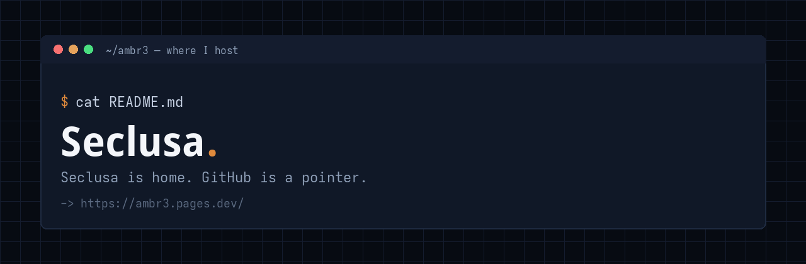

# Seclusa lives on my site



GitHub is fine for mirrors and issues.  
**Home is [ambr3.pages.dev](https://ambr3.pages.dev/).**

This repo exists so anyone who lands on my GitHub profile isn’t left guessing. I don’t treat GitHub as the place you *must* go to run or read my stuff.

---

**Go here instead**

```
site     https://ambr3.pages.dev/
apps     https://ambr3.pages.dev/#apps
source   https://ambr3.pages.dev/source/      # ~/source
about    https://ambr3.pages.dev/about/
privacy  https://ambr3.pages.dev/privacy/
```

---

## Why not “just GitHub”?

I build **privacy-first PWAs**. Notes, calendar, games — your data stays in the browser. No accounts. No trackers. No ads. Weather only hits [Open-Meteo](https://open-meteo.com/) when you ask.

That only holds if the *whole surface* matches: apps and source on one static origin I control, with a hard CSP and no analytics bolted on for vanity metrics.

`~/source` is a proper source browser on that same site. You can open the code in a tab. No login required. Unfinished work can sit there until it’s ready for a public git remote.

The site is plain files on Cloudflare Pages. What you download is what runs. That’s the point.

GitHub still has a job — collaboration, issues, the occasional mirror. It’s not the canonical home. If a repo here looks empty or thin, check **`~/source`**. That’s usually where the real tree is.

---

```
# one line
Seclusa is home. GitHub is a pointer.
```

— ambr3
